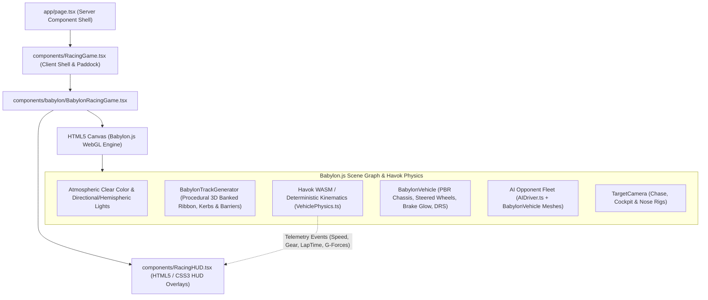

# Architecture & Technical Design

This document details the software architecture, rendering pipeline, and mathematical models powering the **Formula Racing 3D** Next.js & Babylon.js application.

---

## 1. System Overview & Hierarchy

The application bridges standard React web UI with high-performance WebGL graphics:

---

## 2. Rendering Pipeline

### Dynamic HTML HUD Overlay vs. 3D World
- **DOM / CSS Layer**: Menus, speedometer, gear indicators, lap timers, and race controls are rendered as semantic HTML elements styled via `app/globals.css`. This prevents expensive canvas text rendering and provides responsive layout adaptation.
- **Babylon.js Canvas Layer**: The 3D scene executes in its own WebGL viewport beneath the HUD overlays with hardware-accelerated rendering.

### Lighting & Environment
- **Hemispheric Light**: `intensity=0.65` for baseline ambient fill with ground color tone.
- **Directional Light**: Positioned at `[50, 70, 30]` with `intensity=1.8` for vehicle and barrier illumination.
- **Atmospheric Clear**: Dynamic track sky color matching regional atmospheric conditions.

---

## 3. Mathematical Foundations

### Track Spline Parameterization
Centerlines are parameterized as closed Catmull-Rom splines in 3D Euclidean space:
$$\mathbf{P}(t) = [X(t), Y(t), Z(t)], \quad t \in [0, 1)$$

Track cross-sections are constructed along the Frenet-Serret tangent $\mathbf{T}(t) = \frac{\mathbf{P}'(t)}{\|\mathbf{P}'(t)\|}$ and normal $\mathbf{N}(t) = \mathbf{T}(t) \times \mathbf{Up}$. Road ribbons, kerbs, and Armco barriers are dynamically extruded along these vectors.

### Aerodynamic Downforce & Drag
High-speed racing stability is governed by square-law aerodynamic formulas:
$$F_{\text{downforce}} = \frac{1}{2} \rho v^2 C_L A$$
$$F_{\text{drag}} = \frac{1}{2} \rho v^2 C_D A$$

When the Drag Reduction System (DRS) is opened, $C_D$ drops significantly, allowing top speeds in excess of 340 km/h.

---

## 4. Operational Invariants

- **Zero Allocations in Simulation Loops**: Scratch vectors are pre-allocated and mutated in-place.
- **Strict Hydration Safety**: All browser APIs and WebGL initializations are guarded inside client effects.
- **Decoupled Physics**: High-rate simulation state runs independently from React re-renders.
