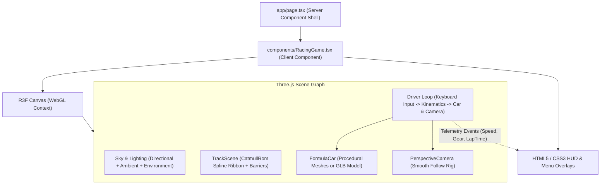

# Architecture & Technical Design

This document details the software architecture, rendering pipeline, and mathematical models powering the **Formula Racing 3D** Next.js & React Three Fiber application.

---

## 1. System Overview & Hierarchy

The application bridges standard React web UI with high-performance WebGL graphics:

---

## 2. Rendering Pipeline

### Dynamic HTML HUD Overlay vs. 3D World
- **DOM / CSS Layer**: Menus, speedometer, gear indicators, lap timers, and race controls are rendered as semantic HTML elements styled via `app/globals.css`. This prevents expensive canvas text rendering and provides responsive layout adaptation.
- **R3F Canvas Layer**: The 3D scene executes in its own WebGL viewport beneath the HUD overlays. Canvas settings use `dpr={[1, 1.6]}` and shadows enabled.

### Lighting & Environment
- **Ambient Light**: `intensity={0.75}` for baseline ambient fill.
- **Directional Light**: Positioned at `[30, 40, 20]` with `intensity={2.1}` and shadow casting for vehicle and barrier shadows.
- **Sky**: `@react-three/drei` procedural sky dome with sun positioning at `[100, 30, 100]`.
- **Environment**: Preset `"city"` provides realistic PBR reflections on vehicle bodywork.

---

## 3. Mathematical Foundations

### Track Ribbon Spline Extrusion
Tracks are authored as an array of 2D coordinates in `data/tracks.ts`.
1. **Catmull-Rom Interpolation**:
   Coordinates are scaled by a factor of 5 and passed to `THREE.CatmullRomCurve3(pts, true, "catmullrom", 0.18)` to produce a continuous closed $C^1$-smooth path in 3D space.
2. **Ribbon Mesh Construction**:
   For each sample point $t \in [0, 1]$:
   - Tangent vector: $\vec{T} = \frac{d P(t)}{dt}$
   - Normal/lateral vector: $\vec{S} = (\vec{T}_z, 0, -\vec{T}_x)$
   - Road surface vertices are offset by $\pm \text{halfWidth}$ along $\vec{S}$.
   - Indices are generated as quad triangle strips, and vertex normals are computed.

### Vehicle Kinematics
The prototype uses a lightweight arcade kinematics model in `Driver`:
- **Heading Angle ($\theta$)**:
  $$\theta_{t + \Delta t} = \theta_t + \text{steering} \times \left(0.8 + \frac{v}{45}\right) \Delta t$$
- **Velocity Integration**:
  $$\vec{P}_{t + \Delta t} = \vec{P}_t + \begin{pmatrix} \sin\theta \\ 0 \\ \cos\theta \end{pmatrix} \cdot v \cdot \Delta t \cdot 0.42$$
- **Camera Damped Follower**:
  - Desired position is computed at an offset behind and above the car:
    $$\vec{C}_{\text{desired}} = \vec{P}_{\text{car}} + \begin{pmatrix} -\sin\theta \cdot 10 \\ 6.2 \\ -\cos\theta \cdot 10 \end{pmatrix}$$
  - Smooth exponential lerp:
    $$\vec{C}_{t + \Delta t} = \text{lerp}\left(\vec{C}_t, \vec{C}_{\text{desired}}, 1 - e^{-4 \Delta t}\right)$$
  - Look-at target: $\vec{P}_{\text{car}} + (0, 1.4, 0)$

---

## 4. State Management & Event Handling

- **Keyboard Input**: Captured via global `keydown` / `keyup` listeners writing to a mutable ref map (`keys.current`). This eliminates React re-renders when keys are pressed or released.
- **Simulation Loop**: Driven by `useFrame((_, delta) => ...)` at the monitor's native refresh rate (60–140 Hz). Time delta is capped at `0.04s` to prevent frame skip tunneling.
- **Telemetry Propagation**: Telemetry data (`speed`, `gear`, `lapTime`) is piped to React state via `onTelemetry` callback for HUD display.
