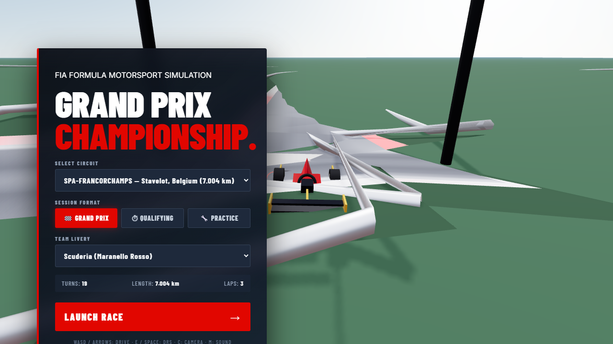

# Formula Racing 3D

A high-performance, browser-based Formula motorsport simulator built with Next.js 14, Babylon.js, Havok Physics WASM, and TypeScript.


---

## Overview

Formula Racing 3D delivers an authentic arcade motorsport experience directly in modern web browsers. Featuring procedural 3D circuit geometry with true elevation profiles, a deterministic vehicle physics engine with downforce modeling, autonomous AI grid opponents, multi-camera perspective switching, and a broadcast-style telemetry HUD.

---

## Visual Showcase

### Paddock & Circuit Selection Menu
Select iconic circuits, choose team liveries, and configure session formats (Grand Prix, Qualifying, or Practice).



### Cockpit & Halo View
Driver-helmet point of view looking out over the titanium halo safety hoop and front nose wing.


### Track-Level Nose Cam
Low-angle track camera delivering an intense sensation of speed at 300+ km/h.


---

## Core Features

### 1. Accurate 3D Circuit Geometry
- **Real-World Elevation Profiles**: Hand-modeled 3D spline curves capturing signature elevation changes, such as the steep Eau Rouge and Raidillon climb at Spa, the Beau Rivage ascent at Monaco, and the high-speed curves of Monza, Silverstone, and Suzuka.
- **Procedural Track Infrastructure**:
  - Multi-lane asphalt road with continuous edge lines and banking.
  - Alternating red-and-white 3D kerbs with raised apex geometry.
  - Distinct runoff zones including AstroTurf strips and gravel traps.
  - Outer Armco metal guardrails preventing vehicles from clipping outside track boundaries.
  - Start/finish overhead gantry with starting lights and checkered grid slots.

### 2. High-Fidelity Formula Vehicle Modeling
- **Detailed Aerodynamic Chassis**: Sculpted monocoque bodywork, aerodynamic sidepods, airbox intake scoop, engine fin, titanium halo, and driver helmet.
- **Dynamic Aerodynamics & DRS**: Front wing with endplates and rear wing with active DRS flap animation.
- **Animated Mechanical Assemblies**:
  - Front wheels physically rotate on steering rack according to driver input.
  - All four wheels rotate continuously around their axles proportional to ground velocity.
  - Sidewall tire compound markings (Soft Red compound).
- **5 Selectable Team Liveries**:
  - Scuderia (Maranello Rosso)
  - Silver Arrow (Stuttgart Silver & Cyan)
  - Papaya (Woking Racing Orange & Blue)
  - Bull Speed (Milton Keynes Navy & Red)
  - Verdant Racing (British Racing Green)

### 3. Realistic Vehicle Physics & Surface Dynamics
- **Aerodynamic Downforce & Drag**: Aerodynamic forces scale with velocity squared ($v^2$), creating heavy high-speed cornering stability while requiring precise throttle control at lower speeds.
- **Tire Traction & Slip Modeling**: Pacejka-inspired lateral friction curves enabling controlled drifts and understeer on corner entries.
- **Surface Friction Detection**:
  - Track Asphalt: 100% grip ($\mu = 1.0$)
  - Kerbs: 85% grip with camera rumble feedback
  - Runoff / Grass: 42% grip with aggressive drag deceleration
- **Barrier Collision Resolution**: Elastic collision response repelling vehicles back into bounds while scrubbing speed.
- **DRS System**: Drag Reduction System reduces aerodynamic drag from 0.44 to 0.28 when activated inside designated DRS zones.

### 4. Autonomous AI Grid Competitors
- **Multi-Car Grid Simulation**: Race against 5 AI drivers with distinct skill profiles and liveries.
- **Curvature-Based Speed Profiling**: AI evaluates upcoming spline curvature to brake into corner entries, clip apexes, and accelerate onto straights.
- **Local Avoidance**: AI drivers detect neighboring vehicles and player proximity to prevent clumping and reckless contact.

### 5. Race Weekend Formats
- **Grand Prix**: Staggered standing start on the grid with official 5-red-lights countdown sequence, multi-lap racing, live leaderboard, and checkered flag completion.
- **Qualifying**: Single-lap hot-lap shootout against the clock.
- **Free Practice**: Solo track session for tuning lines, braking points, and sector split times.

### 6. Broadcast-Grade F1 Telemetry HUD
- **Live Timing Tower**: Positions (P1 through P6), driver numbers, and real-time gap intervals.
- **Shift Light Bar**: 15-LED tachometer bar transitioning from green to yellow to red, with blue flash at the optimal shift point.
- **Digital Cockpit Cluster**: Speedometer (km/h), gear indicator (1–8 and Reverse), and live RPM readout.
- **Telemetry Card**: Lap counters, sector split indicators (S1, S2, S3), sector delta timers, and lateral/longitudinal G-force meters.

### 7. Procedural Web Audio Engine
- **V6 Turbo-Hybrid Synthesizer**: Web Audio API oscillator bank modeling RPM-dependent engine whine, exhaust distortion, and ignition cut gear pops.
- **Tire Squeal Generator**: Dynamic audio feedback under heavy braking or hard cornering slides.
- **Zero External Audio Assets**: Completely procedural sound with zero asset download latency.

---

## Technical Architecture & Invariants

```text
formula-racing-nextjs/
├── app/
│   ├── globals.css              # Styling for racing HUD, menus, and typography
│   ├── layout.tsx               # Root layout and font configuration
│   └── page.tsx                 # Entry page mounting the RacingGame shell
├── components/
│   ├── RacingGame.tsx           # Paddock menu shell and Babylon game mounting
│   ├── RacingHUD.tsx            # Timing tower, shift lights, and telemetry overlay
│   └── babylon/
│       ├── BabylonRacingGame.tsx    # Babylon.js engine, render loop, and camera
│       ├── BabylonTrackGenerator.ts # Procedural 3D track ribbon, kerbs, and barriers
│       └── BabylonVehicle.ts        # PBR car model with animated wheels and DRS
├── data/
│   ├── tracks.ts                # 3D circuit waypoints, elevation, and sector data
│   └── liveries.ts              # Team livery definitions
├── lib/
│   ├── ai/
│   │   └── AIDriver.ts          # AI pathfinding, speed profiles, and collision avoidance
│   ├── audio/
│   │   └── EngineSound.ts       # Procedural Web Audio API sound synthesizer
│   ├── babylon/
│   │   └── havokLoader.ts       # Havok WASM physics plugin loader
│   ├── math/
│   │   └── Spline3D.ts          # Arc-length parameterized Catmull-Rom spline
│   └── physics/
│       └── VehiclePhysics.ts    # Downforce, tire friction, collisions, and telemetry
├── public/
│   └── screenshots/             # In-game preview images
├── ARCHITECTURE.md              # In-depth mathematical and rendering documentation
├── CONTRIBUTING.md              # Contributor standards and guidelines
└── ROADMAP.md                   # Phased development roadmap
```

### Performance Standards
- **Zero Allocations Inside Render Loops**: Scratch vectors are allocated once using refs or module-level variables and mutated in-place to prevent garbage collection pauses.
- **React State Decoupling**: High-frequency vehicle simulation runs at native refresh rate (60–140 Hz) inside mutable refs; HUD telemetry is updated efficiently to maintain high rendering throughput.

---

## Controls

| Key | Action |
| :--- | :--- |
| **W** / **Arrow Up** | Accelerate |
| **S** / **Arrow Down** | Brake / Reverse |
| **A** / **Arrow Left** | Steer Left |
| **D** / **Arrow Right** | Steer Right |
| **E** / **Spacebar** | Activate DRS (in DRS zones) |
| **C** | Cycle Camera (Chase / Cockpit / Nose) |
| **M** | Mute / Unmute Audio |
| **Escape** | Pause Race |

---

## Getting Started

### Prerequisites
- Node.js 20 or newer
- npm
- Web browser with WebGL 2.0 acceleration enabled (Chrome, Edge, Firefox, Brave)

### Installation & Run

1. Clone or navigate to the repository directory:
   ```bash
   cd formula-racing-nextjs
   ```

2. Install dependencies:
   ```bash
   npm install
   ```

3. Launch development server:
   ```bash
   npm run dev
   ```

4. Open [http://localhost:3000](http://localhost:3000) in your browser.

### Production Build

```bash
npm run build
npm run start
```

---

## License & Asset Disclaimer

This project is an independent educational and technical demonstration. It uses generic original styling and hand-authored track approximations for gameplay prototyping. It is not affiliated with, endorsed by, or sponsored by Formula One, the FIA, or any racing teams.
