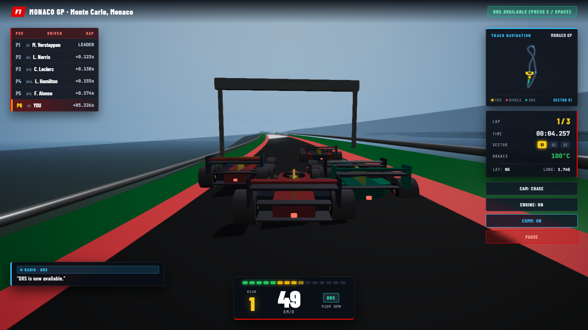
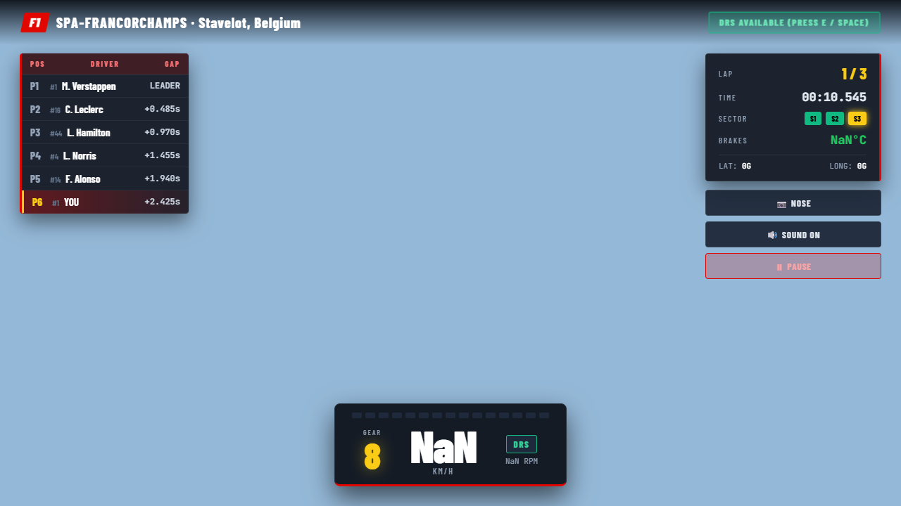

<p align="center">
  
</p>

<p align="center">
  <strong>High-Performance Browser-Based 3D Open-Wheel Motorsport Simulator</strong><br>
  Built with Next.js 14, Babylon.js 9, Havok Physics WebAssembly, and TypeScript.
</p>

---

## Overview

**Formula Racing 3D** is an open-source, web-based 3D motorsport simulation engineered to run in modern browsers. Powered by **Babylon.js** and **Havok Physics WASM**, the game features procedural 3D banked circuits with true elevation changes, deterministic vehicle dynamics with aerodynamic downforce, autonomous AI opponents, dynamic particle effects, automatic sequential transmission, and real-time voice race commentary via the browser Web Speech API.

---

## Visual Showcase

### In-Race Chase Camera
High-speed racing view featuring dynamic directional shadows, procedural atmospheric sky, and broadcast telemetry HUD.



### Cockpit & Halo Perspective
Driver-eye point of view looking out over the safety hoop, monocoque chassis, and rotating steering assembly.


### Track-Level Nose Cam
Low track camera angle delivering a high-speed sensation down straights and through sweeping corners.



### Paddock & Circuit Selection Menu
Interactive garage interface to select circuits, choose custom liveries, and configure race sessions.


---

## Core Features

### Real-Time Voice Race Commentary
- **In-Browser Audio Commentary**: Built-in speech synthesis engine (`lib/commentary/RaceCommentary.ts`) using the standard browser Web Speech API.
- **Contextual Race Alerts**: Real-time voice announcements for race start countdowns, overtakes, lap transitions, personal best sectors, DRS availability, track limits, and checkered flag finishes.
- **Zero Cloud Services**: Operates entirely client-side with no external audio downloads or API keys.

### Dynamic Particle Systems
- **Barrier Collision Sparks (`lib/effects/BarrierSparkSystem.ts`)**: High-velocity spark particles triggered when vehicles contact perimeter Armco barriers.
- **Tire Smoke & Lockups (`lib/effects/TireSmokeSystem.ts`)**: Volumetric smoke particles generated during heavy threshold braking, tire lockups, and lateral slides.
- **Post-Processing & Atmosphere**: Bloom highlights, FXAA edge smoothing, tone mapping, and a procedural skybox.

### Powertrain & Automatic Transmission
- **8-Speed Sequential Gearbox**: Automatic gear selection mapped to realistic torque curves.
- **Smart Shift Timing**: Shift delay timers and downshift kickdown logic prevent erratic gear hunting mid-turn.
- **Aerodynamics & DRS**: Drag Reduction System reduces aerodynamic drag when activated along designated straightaway zones.

### 6 Procedural 3D Circuits
Six distinct track layouts featuring elevation gradients, banked corners, and high-speed technical complexes:
1. **Ardennes Forest Circuit** (7,004m) — High elevation climb through sweeping uphill curves.
2. **Riviera Street Circuit** (3,337m) — Tight seaside street circuit with elevation ascents and technical chicanes.
3. **Grand Prix Park** (5,891m) — High-speed aerodynamic layout with flowing high-G turns.
4. **Royal Autodrome** (5,793m) — Classic high-velocity circuit with heavy braking zones and long straights.
5. **Alpine Ring** (5,807m) — Figure-eight technical circuit featuring sweeping elevation changes.
6. **Coastal GP Raceway** (4,309m) — Undulating terrain with downhill apexes and uphill straights.

### Procedural Track Infrastructure
- **Banked Roadways**: Continuous 3D ribbon geometry with asphalt texturing, edge boundaries, and banking.
- **Apex Kerbs**: Alternating red-and-white 3D kerbs with tactile chassis feedback.
- **Variable Friction Zones**:
  - Track Surface: Full traction
  - Kerb Apex: Moderate grip with rumble feedback
  - Runoff & Gravel: Reduced grip with deceleration drag
- **Perimeter Barriers**: Elastic guardrail collisions that redirect cars back onto the track.
- **Start/Finish Gantry**: Overhead structure with starting lights sequence and grid slots.

### Autonomous AI Competitors
- **Multi-Car Grid**: Race against 5 AI drivers with distinct skill profiles and liveries.
- **Curvature Speed Profiling**: AI drivers evaluate upcoming track radius to calculate braking points, apex speeds, and acceleration zones.
- **Spatial Avoidance**: Local vehicle avoidance prevents artificial clumping and reckless contact.

### Broadcast Telemetry HUD
- **Live Timing Tower**: Real-time position tracking and gap intervals.
- **Shift Light Indicator**: 15-LED tachometer bar transitioning from green to yellow, red, and blue shift flash.
- **Digital Instrument Cluster**: Speedometer, gear readout, and live engine RPM.
- **Telemetry Readout**: Sector split times, lap counters, and lateral/longitudinal G-force meter.

### Procedural Web Audio Engine
- **Synthesized Engine Sound**: Multi-oscillator audio generator modeling engine whine, turbo spool, and gear pops.
- **Dynamic Tire Squeal**: Audio pitch and volume modulate based on slip angle and braking intensity.
- **Zero Audio Assets**: Entirely synthesized in real-time via the Web Audio API.

---

## Controls

| Key | Alternative | Action |
| :--- | :--- | :--- |
| **W** | **Up Arrow** | Throttle / Accelerate |
| **S** | **Down Arrow** | Brake / Reverse (when stationary) |
| **A** | **Left Arrow** | Steer Left |
| **D** | **Right Arrow** | Steer Right |
| **E** | **Spacebar** | Toggle DRS (in straightaway zones) |
| **C** | — | Cycle Camera (Chase / Cockpit / Nose) |
| **M** | — | Mute / Unmute Audio Synthesizer & Voice Commentary |
| **Escape** | — | Return to Paddock Menu |

---

## Session Modes

- **Grand Prix**: Staggered standing grid start with 5-light countdown sequence, multi-lap racing, live leaderboard, and checkered flag.
- **Qualifying**: Single-car hot-lap session against the clock.
- **Free Practice**: Solo circuit driving for mastering racing lines, braking markers, and sector times.

---

## Getting Started

### Prerequisites
- Node.js 20 or newer
- npm 9 or newer
- Modern web browser with WebGL 2.0 support (Chrome, Edge, Firefox, Brave, Safari 16+)

### Installation & Run

1. Clone the repository:
   ```bash
   git clone https://github.com/layanpro123456/formula-racing-3d.git
   cd formula-racing-3d
   ```

2. Install dependencies:
   ```bash
   npm install
   ```

3. Start local development server:
   ```bash
   npm run dev
   ```

4. Open [http://localhost:3000](http://localhost:3000) in your browser.

### Production Build

```bash
npm run build
npm run start
```

---

## Project Structure

```text
formula-racing-3d/
├── app/
│   ├── globals.css              # Telemetry HUD, menus, and typography
│   ├── icon.svg                 # Vector browser icon
│   ├── layout.tsx               # Root layout and metadata
│   └── page.tsx                 # Main entry point mounting the game
├── components/
│   ├── RacingGame.tsx           # Garage menu shell and game mounting
│   ├── RacingHUD.tsx            # Shift lights, timing tower, and HUD
│   └── babylon/
│       ├── BabylonRacingGame.tsx    # Scene manager, physics, and render loop
│       ├── BabylonTrackGenerator.ts # Procedural 3D track ribbon, kerbs, barriers
│       └── BabylonVehicle.ts        # PBR car model, animated wheels, DRS
├── data/
│   ├── liveries.ts              # Livery color schemes and PBR materials
│   └── tracks.ts                # Track waypoint spline definitions
├── lib/
│   ├── ai/
│   │   └── AIDriver.ts          # AI grid simulator and pathfinding
│   ├── audio/
│   │   └── EngineSound.ts       # Synthesized Web Audio API engine sound
│   ├── babylon/
│   │   └── havokLoader.ts       # Havok WASM physics loader
│   ├── commentary/
│   │   └── RaceCommentary.ts    # Web Speech API race commentary
│   ├── effects/
│   │   ├── BarrierSparkSystem.ts # Particle spark system on collisions
│   │   └── TireSmokeSystem.ts    # Particle tire smoke on lockups
│   ├── input/
│   │   └── InputManager.ts      # Keyboard input and analog smoothing
│   ├── math/
│   │   └── Spline3D.ts          # Arc-length Catmull-Rom spline calculations
│   └── physics/
│       └── VehiclePhysics.ts    # Downforce, tire slip, automatic gearbox
├── public/
│   ├── HavokPhysics.wasm        # Havok physics WebAssembly binary
│   ├── logo.svg                 # Vector brand logo
│   └── screenshots/             # In-game capture screenshots
├── ARCHITECTURE.md              # Simulation maths and graphics architecture
├── CONTRIBUTING.md              # Development and contribution standards
├── ROADMAP.md                   # Feature roadmap
└── package.json                 # Project configuration
```

---

## License & Disclaimers

This project is open-source and available under the terms of the [MIT License](https://opensource.org/licenses/MIT).

> **Disclaimer**: This simulator is an independent educational and technical demonstration. It uses original generic vehicle models, stylized liveries, and approximate hand-authored track geometries. It is not affiliated with or endorsed by any commercial motorsport organization, racing series, or automotive manufacturer.
