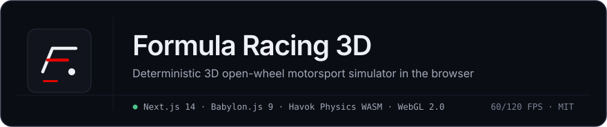
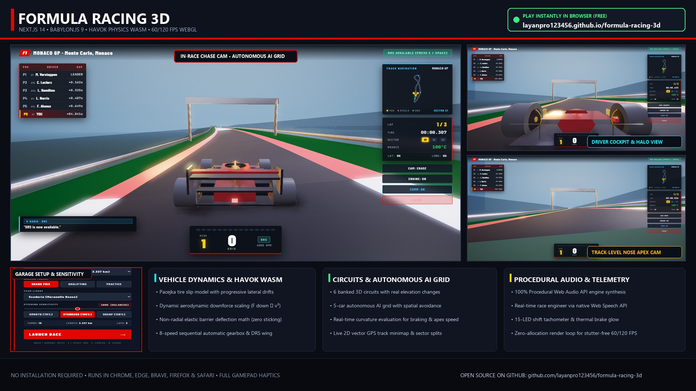
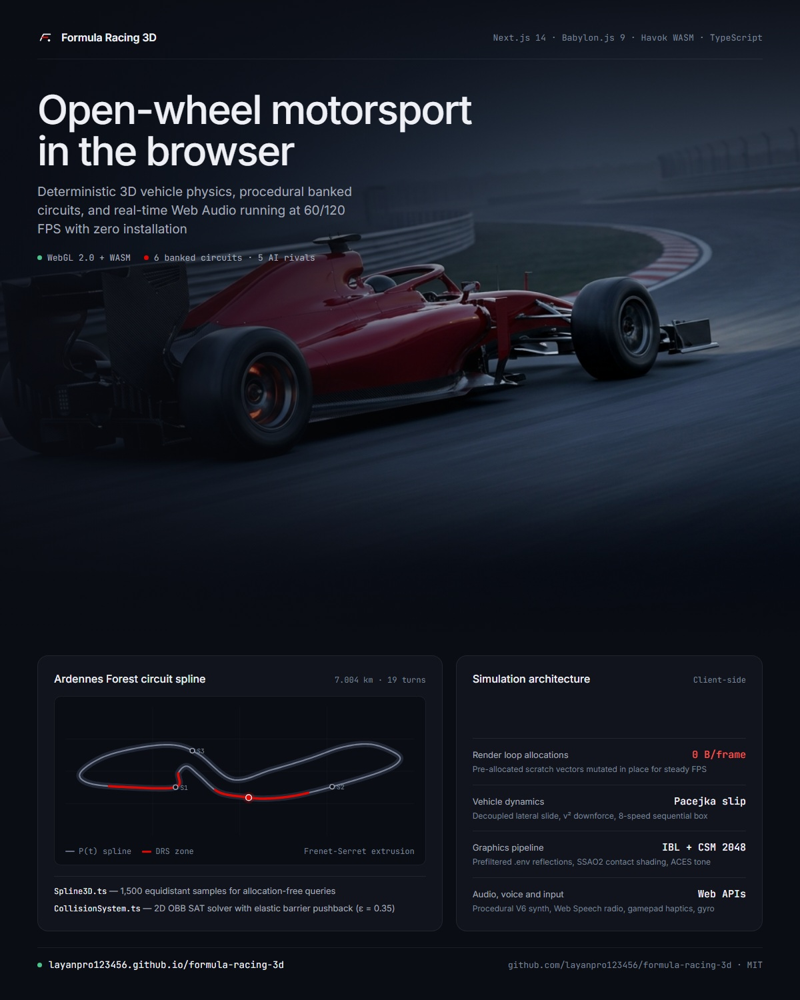
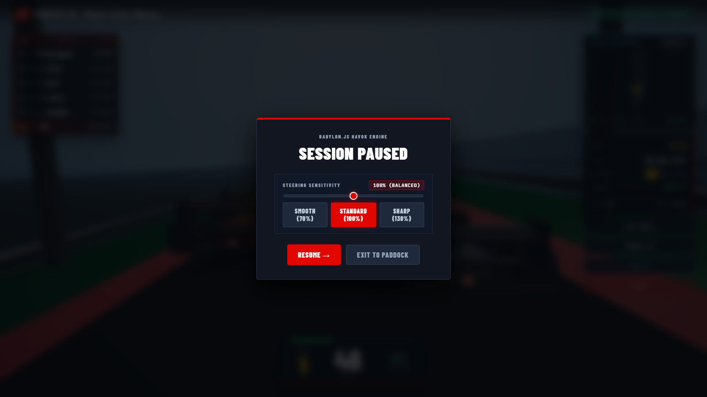
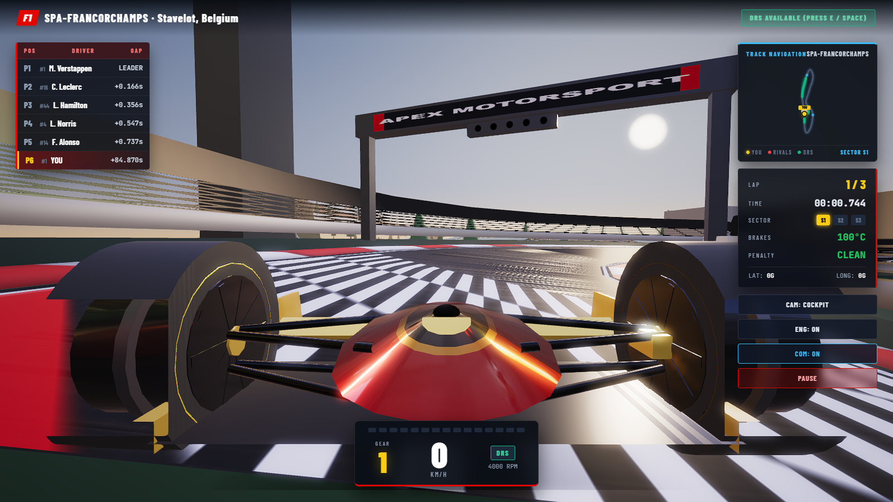

<p align="center">
  
</p>

<p align="center">
  <a href="https://layanpro123456.github.io/formula-racing-3d/"></a>
  <a href="https://nextjs.org"></a>
  <a href="https://www.babylonjs.com"></a>
  <a href="https://www.havok.com"></a>
  <a href="https://www.typescriptlang.org"></a>
  <a href="https://developer.mozilla.org/en-US/docs/Web/API/WebGL_API"></a>
  <a href="https://opensource.org/licenses/MIT"></a>
</p>

<p align="center">
  <strong>High-Performance Browser-Based 3D Open-Wheel Motorsport Simulator</strong><br>
  Engineered with Next.js 14, Babylon.js 9, Havok Physics WebAssembly, and Procedural Web Audio.<br><br>
  🏁 <strong><a href="https://layanpro123456.github.io/formula-racing-3d/">Play Instant In-Browser Demo (No Download Required) &rarr;</a></strong>
</p>

---

## 🌐 Live Interactive Demo

Experience the full 3D simulation running live at 60/120 FPS directly in your browser:

👉 **[https://layanpro123456.github.io/formula-racing-3d/](https://layanpro123456.github.io/formula-racing-3d/)**

- **Zero Install / Instant Play**: Compiled to a static client-side bundle and hosted globally on GitHub Pages.
- **Hardware-Accelerated Physics**: Powered by Havok Physics compiled to WebAssembly (WASM).
- **Plug & Play Controllers**: Native support for Xbox and PlayStation gamepads with dual-motor haptic rumble, plus zero-latency keyboard controls.
- **6 Championship Circuits**: Ardennes Forest, Riviera Street Circuit, Grand Prix Park, Royal Autodrome, Alpine Ring, and Coastal GP Raceway.

---

## 🏎️ Overview

**Formula Racing 3D** is a production-grade, web-based 3D motorsport racing simulator running at 60/120 FPS directly in the browser. Powered by **Babylon.js** and **Havok Physics WASM**, the game features procedural 3D banked circuits with true elevation changes, deterministic vehicle dynamics with Pacejka tire slip, elastic barrier deflections, autonomous AI competitors, real-time voice race commentary, live vector GPS track navigation, and user-configurable steering sensitivity.

---

## 📸 Visual Showcase

### Official Simulator Promotional Poster (16:9 Landscape)
*High-resolution composite showcase combining in-race chase action, driver cockpit view, track-level nose cam, paddock garage setup, and simulation architecture specs.*

<p align="center">
  
</p>

---

### Official Box-Art Poster (Portrait Edition)
*Vertical presentation format designed for mobile showcases, community feeds, and high-impact visual display.*

<p align="center">
  
</p>

---

### In-Race Action (Low Chase Camera)
*Low dynamic chase perspective featuring real-time directional shadows, procedural atmospheric sky, 15-LED shift tachometer, live timing tower, and the top-right vector minimap.*

<p align="center">
  
</p>

---

### Paddock Garage & Circuit Selection Menu
*Interactive paddock setup interface for selecting circuits, session formats (Grand Prix, Qualifying, Practice), team liveries, and calibrating **Steering Sensitivity** ($50\% - 150\%$) with quick presets.*

<p align="center">
  
</p>

---

### In-Game Pause & Sensitivity Calibration Screen
*Seamless mid-race pause overlay accessible via `ESC` / `P` to fine-tune steering responsiveness on the fly without forfeiting race progress or reloading the 3D scene.*

<p align="center">
  
</p>

---

### Cockpit & Halo Perspective
*Driver-eye point of view looking out over the titanium Halo safety structure, cockpit monocoque, rotating steering yoke, and front suspension assemblies.*

<p align="center">
  
</p>

---

### Track-Level Nose Cam
*Ultra-low bumper camera angle delivering a high-speed rush down long straights and through technical corner complexes.*

<p align="center">
  
</p>

---

## ⚡ Game Features

### 🏎️ Advanced Vehicle Dynamics & Elastic Barrier Physics
- **Dynamic Bicycle Model with Pacejka Slip**: Decoupled forward ($u$) and lateral ($v$) chassis velocities. Tires transition into a controllable lateral slide when cornering forces exceed downforce grip thresholds ($F_{\text{lat}} > \mu \cdot N$).
- **Zero "Magnetic Barrier Trap"**: Non-radial elastic collision resolution ($\epsilon = 0.35$) with penetration pushback that naturally deflects the vehicle nose away from perimeter Armco barriers back toward the racing line.
- **Low-Speed 3-Point Maneuvers**: Full steering authority and reverse gear rotation allow drivers to escape tight runoffs and perform stationary spin-turns.
- **Aerodynamic Ground Effects & DRS**: Dynamic downforce scales with the square of forward velocity ($F_{\text{down}} \propto v^2$), while the Drag Reduction System (DRS) trims rear wing drag along straightaway zones.

---

### 🗺️ Live Vector Track Navigation Map (Minimap)
- **Mathematical Spline Projection**: Real-time 2D vector minimap anchored in the top-right HUD, projecting the Catmull-Rom circuit spline with outer asphalt margins and racing centerline.
- **Live Competitor Tracking**:
  - **Player Beacon**: Pulsing golden indicator with an expanding radar pulse ring (`YOU`).
  - **AI Grid Rivals**: Color-coded circular markers rendered in their authentic team livery palettes.
- **Circuit Intelligence**: Visualizes sector split markers (`S1`, `S2`, `S3`), start/finish line tick, and active DRS zones highlighted in glowing neon green.

---

### 🎮 Zero-Latency Controller & Steering Sensitivity
- **Custom Sensitivity Curve ($50\% - 150\%$)**: Configurable in $5\%$ increments with instant visual feedback badges (`SMOOTH`, `BALANCED`, `SHARP`) and quick preset pills:
  - `SMOOTH (70%)`: High-speed stability and gentle cornering transitions.
  - `STANDARD (100%)`: Balanced factory simulation baseline.
  - `SHARP (130%)`: Rapid corner turn-in for high-precision apex clipping.
- **Dual UI Control Points**: Calibrate steering in both the Paddock Garage Menu and live in-race via the Pause Menu (`ESC` / `P`).
- **Input Responsiveness**: Keyboard steering features instant attack ($24\text{ rad/s}$) and fast spring return-to-center ($36\text{ rad/s}$). Gamepad analog sticks utilize direct cubic response mapping.
- **Dual-Motor Gamepad Haptics**: Implements Web Gamepad Vibration Actuator API for tactile feedback during barrier impacts, kerb rumble, and brake lockups.
- **Settings Persistence**: Saves automatically to browser `localStorage` (`f1_steering_sensitivity`).

---

### 🎙️ Real-Time Voice Race Commentary
- **In-Browser Speech Synthesis**: Real-time contextual race engineer audio powered by the client-side Web Speech API with zero external dependencies.
- **Smart Event Triggering**: Voice callouts for 5-light start sequences, position gains/overtakes, lap transitions, personal best sectors, DRS zone activation, off-track limits warnings, and checkered flag finishes.
- **Bottom-Left Broadcast Banner**: Floating HUD notification banner with auto-dismiss timers and team radio styling positioned safely outside the driver's forward sightlines.

---

### 🏁 6 Procedural 3D Banked Circuits & Trackside Props
Six accurately modeled championship circuits with true 3D elevation gradients and cambered banking:
1. **Ardennes Forest Circuit** (7,004m) — Sweeping elevation ascents through high-speed uphill sweeps.
2. **Riviera Street Circuit** (3,337m) — Narrow seaside barrier-lined street circuit with technical chicanes.
3. **Grand Prix Park** (5,891m) — High-downforce modern layout with flowing high-G esses.
4. **Royal Autodrome** (5,793m) — Classic temple of speed with heavy braking zones and slipstream straights.
5. **Alpine Ring** (5,807m) — Figure-eight technical layout with dramatic elevation crests and dips.
6. **Coastal GP Raceway** (4,309m) — Undulating oceanfront circuit with downhill apex entries.

**Track Infrastructure**:
- **3D Apex Kerbs**: Chamfered red-and-white rumble kerbs with tactile chassis elevation kick.
- **Trackside Brake Markers**: Prominent **150m**, **100m**, and **50m** distance countdown boards approaching heavy braking zones.
- **Safety Barriers & Catch Fencing**: Continuous Armco steel barriers lined with protective wire catch-fencing.
- **Start/Finish Gantry Bridge**: Structural overhead gantry housing the 5-red-light starting array.

---

### 🤖 Autonomous Multi-Car AI Grid
- **Intelligent Grid Racing**: Race against 5 autonomous AI drivers, each representing distinct constructor teams and driver profiles.
- **Curvature Speed Profiling**: AI drivers evaluate upcoming track radius vectors in real-time to compute optimal braking thresholds, corner apex speeds, and exit acceleration profiles.
- **Local Spatial Avoidance**: Multi-car collision avoidance prevents artificial procession trains and reckless side-by-side collisions.

---

### ⚙️ 8-Speed Sequential Transmission & Procedural Web Audio
- **Automatic Sequential Gearbox**: Shift points calculated from dynamic torque curves, featuring kickdown downshifts and shift hesitation timers to prevent erratic gear hunting.
- **100% Procedural Web Audio Engine**: Multi-oscillator synthesis generating authentic V6 turbo-hybrid engine whine, turbo spool, gear change ignition cuts, and slip-dependent tire squeal without external audio files.

---

### 🌟 AAA Graphics Pipeline, IBL Environment & Shaders
- **Image-Based Lighting (IBL) & Environment Reflections**: Prefiltered spherical harmonics `.env` environment texture (`environmentSpecular.env`) driving real-time Cook-Torrance microfacet specular reflections across all car clearcoats, alloy wheels, and trackside metals.
- **Cascaded Shadow Generator (CSM 2048)**: 3-tier cascaded shadow mapping with contact hardening (`useContactHardeningShadow`), producing razor-sharp tire contact shadows directly under the chassis and natural diffuse penumbras along distant kerbs.
- **Screen-Space Ambient Occlusion (SSAO2)**: Depth buffer ambient occlusion providing realistic ground contact shading for tires, suspension wishbones, and Armco barriers, completely eliminating the "floating car" look.
- **PBR Asphalt Normal Bump Mapping**: High-frequency procedural tangent-space normal bump maps (`bumpTexture`) simulating aggregate stone micro-facets, paired with low-roughness rubbered racing grooves and a clearcoat layer for authentic specular asphalt sheen.
- **Automotive Clearcoat & Pirelli-Style Sidewalls**: Multi-layer high-gloss car lacquer (`clearCoat: 1.0`, `roughness: 0.03`), carbon fiber floor undertray, glowing carbon-ceramic brake rotors, and colored tire compound sidewall rings.
- **Cockpit LCD Telemetry Screen**: Active digital LCD instrument cluster mounted directly on the steering wheel yoke with progressive shift LEDs and telemetry readouts.
- **Cinematic Post-Processing Pipeline**: Babylon.js Default Rendering Pipeline featuring ACES photographic tonemapping, bloom highlights, subtle vignette, FXAA edge smoothing, edge sharpening, speed lens chromatic aberration, filmic grain, and velocity-dependent motion blur (scaling to `0.65` at top speed).
- **Dynamic Particle VFX**: High-velocity titanium floor skid sparks and barrier collision sparks emitted along the asphalt plane, plus procedural tire smoke plumes during threshold brake lockups.

---

### 📺 Broadcast F1 Telemetry HUD
- **15-LED Shift Light Tachometer**: Progressive green $\to$ yellow $\to$ red $\to$ flashing blue shift lights.
- **Digital Instrument Cluster**: Large digital speedometer (km/h), gear selector readout, and live engine tachometer.
- **Live Timing Tower**: Real-time position order (P1–P6) and dynamic gap intervals to leader and rivals.
- **Real-Time Telemetry Cards**: Sector split timing, lap counters, brake rotor temperatures with glowing thermal emissive effects, and lateral/longitudinal G-force accelerometer.

---

## 🕹️ Controls Guide

| Action | Primary (Keyboard) | Alternative (Keyboard) | Gamepad (Xbox / DualShock) |
| :--- | :--- | :--- | :--- |
| **Throttle / Accelerate** | `W` | `Up Arrow` | `Right Trigger (RT / R2)` |
| **Brake / Reverse** | `S` | `Down Arrow` | `Left Trigger (LT / L2)` |
| **Steer Left** | `A` | `Left Arrow` | `Left Stick (Left)` |
| **Steer Right** | `D` | `Right Arrow` | `Left Stick (Right)` |
| **Toggle DRS** | `E` | `Spacebar` | `A / Cross Button` |
| **Cycle Camera** | `C` | — | `Y / Triangle Button` |
| **Pause Session** | `Escape` | `P` | `Start / Options Button` |
| **Mute / Unmute Audio** | `M` | — | — |

---

## 🚦 Session Formats

- **Grand Prix**: 5-red-light starting gantry countdown sequence, full AI competitor grid, multi-lap racing, live timing gaps, and checkered flag finish.
- **Qualifying**: Single-car hot-lap format with empty circuit for setting the ultimate pole position lap time.
- **Free Practice**: Open circuit session for dialing in steering sensitivity, testing braking markers, and optimizing racing lines.

---

## 🚀 Getting Started

### Prerequisites
- [Node.js](https://nodejs.org) 20.0 or higher
- [npm](https://www.npmjs.com) 9.0 or higher
- Modern web browser with WebGL 2.0 support (Chrome, Edge, Firefox, Brave, Safari 16.4+)

### Installation & Local Run

1. **Clone the repository**:
   ```bash
   git clone https://github.com/layanpro123456/formula-racing-3d.git
   cd formula-racing-3d
   ```

2. **Install project dependencies**:
   ```bash
   npm install
   ```

3. **Start the local Next.js development server**:
   ```bash
   npm run dev
   ```

4. **Launch the simulator**:
   Navigate to [http://localhost:3000](http://localhost:3000) in your browser.

### Production Build & Static Export

```bash
# Build optimized static production bundle
npm run build

# Serve static production export
npx serve out
```

---

## 📂 Repository Layout

```text
formula-racing-3d/
├── app/
│   ├── globals.css              # Telemetry HUD, paddock styling, and range sliders
│   ├── icon.svg                 # Vector browser favicon
│   ├── layout.tsx               # Root layout, viewport metadata, and fonts
│   └── page.tsx                 # Main application entry point
├── components/
│   ├── RacingGame.tsx           # Paddock garage menu shell & session configurator
│   ├── RacingHUD.tsx            # Shift lights, timing tower, and telemetry HUD
│   ├── TrackNavigationMap.tsx   # Top-right 2D vector GPS circuit minimap
│   └── babylon/
│       ├── BabylonRacingGame.tsx    # Babylon.js engine, render loop, and camera
│       ├── BabylonTrackGenerator.ts # Procedural 3D banked ribbon, kerbs, barriers
│       └── BabylonVehicle.ts        # PBR car model with animated wheels and DRS
├── data/
│   ├── liveries.ts              # Team livery definitions and PBR materials
│   └── tracks.ts                # Track waypoints, sector splits, and DRS zones
├── lib/
│   ├── ai/
│   │   └── AIDriver.ts          # AI grid simulator and curvature pathfinding
│   ├── audio/
│   │   └── EngineSound.ts       # Synthesized Web Audio API sound engine
│   ├── babylon/
│   │   └── havokLoader.ts       # Havok WASM physics plugin loader
│   ├── commentary/
│   │   └── RaceCommentary.ts    # Web Speech API race commentary announcer
│   ├── effects/
│   │   ├── BarrierSparkSystem.ts # Particle spark system on collisions
│   │   └── TireSmokeSystem.ts    # Particle tire smoke on lockups
│   ├── input/
│   │   └── InputManager.ts      # Keyboard/gamepad inputs & steering sensitivity
│   ├── math/
│   │   └── Spline3D.ts          # Arc-length Catmull-Rom spline calculations
│   └── physics/
│       └── VehiclePhysics.ts    # Pacejka tire slip, downforce, gearbox, barriers
├── public/
│   ├── assets/
│   │   └── environment/
│   │       └── environmentSpecular.env # Prefiltered IBL environment reflection probe
│   ├── HavokPhysics.wasm        # Havok physics WebAssembly binary
│   ├── logo.svg                 # Vector brand logo
│   ├── promotional_poster.jpg   # Master 1920x1080 promotional showcase poster
│   ├── social_preview.jpg       # OpenGraph 16:9 social media promotional banner
│   └── screenshots/             # High-resolution visual showcase captures
│       ├── promotional_poster.jpg          # 1920x1080 landscape showcase poster
│       ├── promotional_poster_portrait.jpg # 1200x1600 portrait box-art poster
│       ├── social_preview.jpg   # 16:9 promotional broadcast banner
│       ├── gameplay_chase.png   # Low chase action view with minimap
│       ├── menu.png             # Paddock garage circuit & sensitivity setup
│       ├── pause_menu.png       # Mid-race pause & live sensitivity slider
│       ├── cockpit_view.png     # Cockpit & Halo driver view
│       └── nose_cam.png         # Front nose bumper camera
├── ARCHITECTURE.md              # Graphics & simulation mathematical architecture
├── CONTRIBUTING.md              # Engineering guidelines & invariant standards
├── ROADMAP.md                   # Future milestones & development roadmap
└── package.json                 # Project dependencies and scripts
```

---

## 📜 Architectural Invariants

- **Zero Allocations in Render Loops**: Never allocate vectors, matrices, or object literals inside `runRenderLoop`. Scratch vectors are pre-allocated and reused in-place (`.copyFrom()`, `.set()`, `Vector3.LerpToRef()`).
- **Physics Decoupled from React State**: High-frequency physics and inputs run in native requestAnimationFrame loops; React state updates are throttled to HUD consumption intervals.
- **Native Browser APIs**: Web Audio API, Web Speech API, and Gamepad API execute client-side with zero external SaaS dependencies.

---

## 📄 License & Disclaimers

This project is open-source under the [MIT License](LICENSE).

> **Disclaimer**: *Formula Racing 3D* is an independent educational engineering demonstration. It employs original generic open-wheel vehicle designs, stylized fictional liveries, and hand-authored track approximations. It is not affiliated with, sponsored by, or endorsed by Formula 1 (F1), the FIA, or any commercial racing organization.
